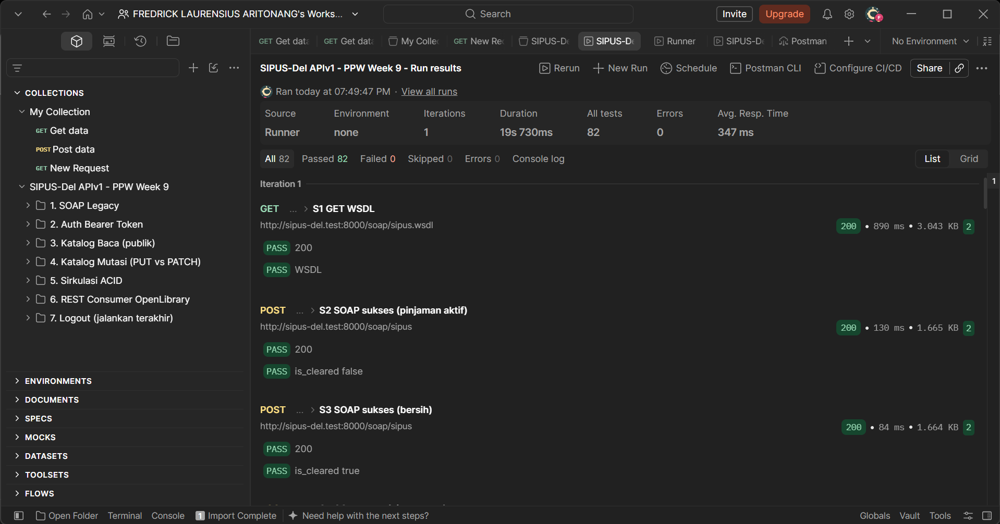
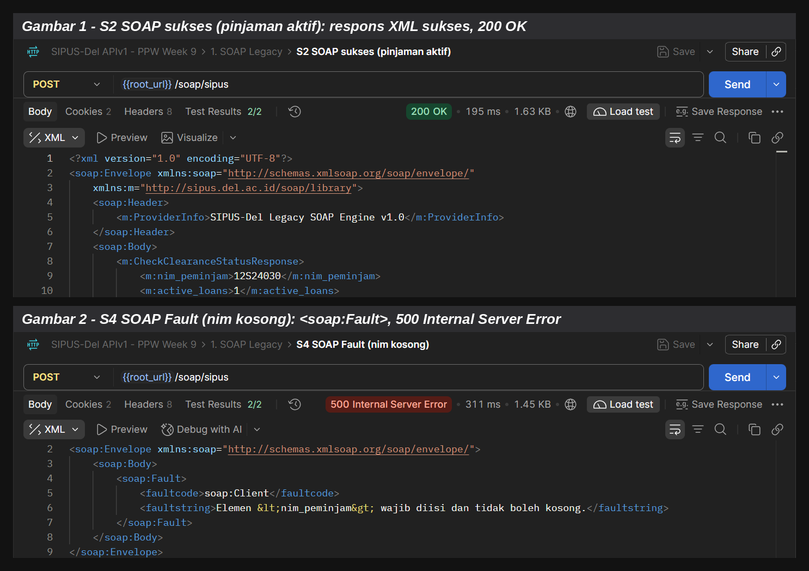
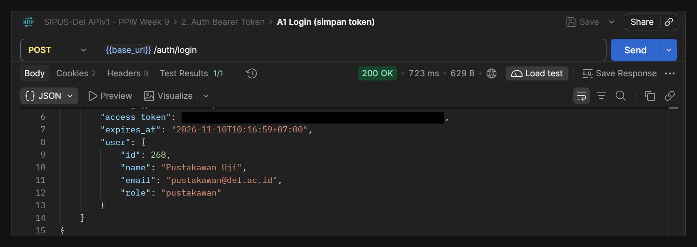
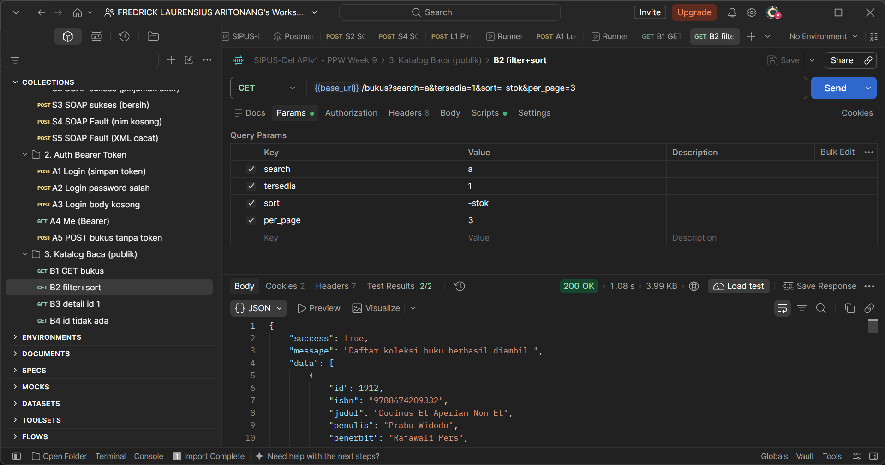
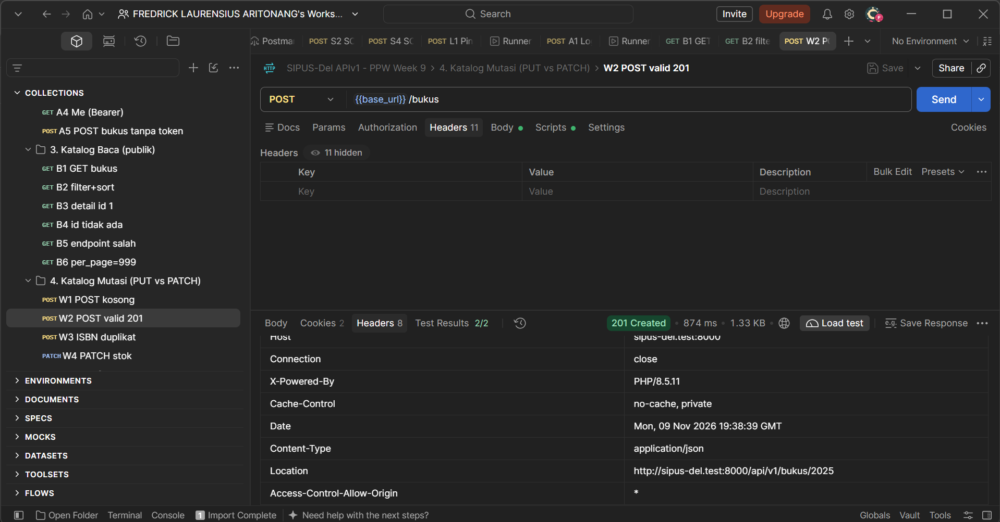
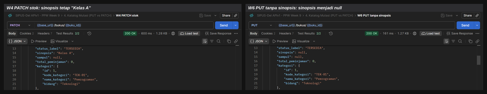
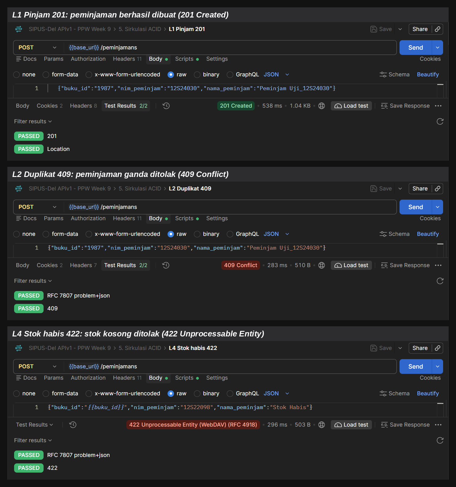
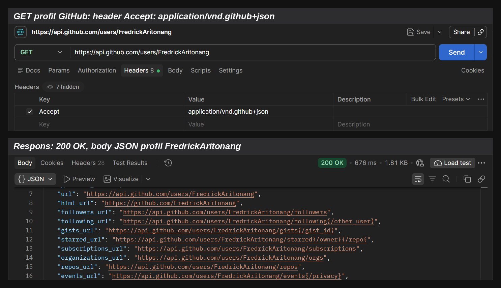
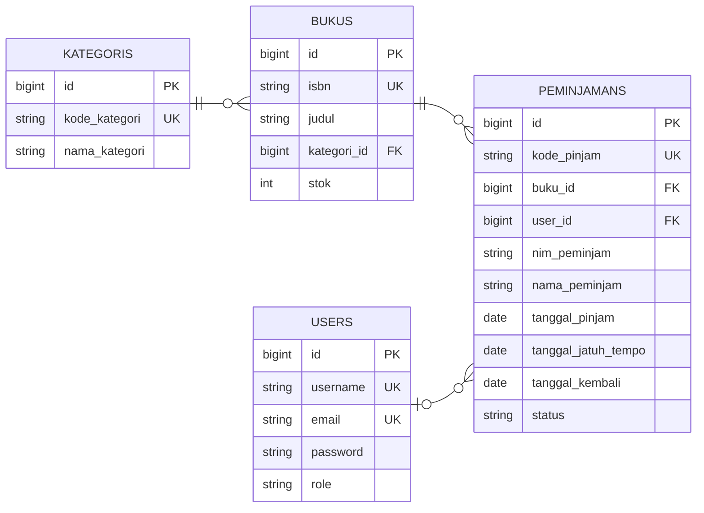

# SIPUS-Del: Sistem Informasi Perpustakaan Kampus Del (Minggu 5, 6, dan 9)

| | |
|---|---|
| **Nama Mahasiswa** | Fredrick Laurensius Aritonang |
| **NIM** | 12S24001 |
| **Kelas** | 13SI1 |
| **Program Studi** | Sistem Informasi |
| **Mata Kuliah** | Pemrograman dan Pengujian Aplikasi Web (12S3101) |
| **Dosen Pengampu** | Chandro Pardede, S.Kom., M.Sc. |

Teknologi: Laravel 11, MySQL (InnoDB), Laravel Sanctum, PHP 8.2 atau lebih baru.
Branch pengumpulan Minggu 9: `week9-rest-api` (melanjutkan `week6-db-session`).
Antarmuka web Blade Minggu 5 dan 6 tetap berfungsi dan tidak diubah.

---

# Minggu 9: Web Services (SOAP dan RESTful API v1)
## 1. Analisis Kebutuhan dan Kelayakan Web Services

UPT Perpustakaan IT Del memiliki tiga kebutuhan integrasi lintas sistem. Aplikasi web Blade (Minggu 5 dan 6) melayani
manusia lewat browser, sedangkan ketiga kebutuhan ini adalah komunikasi **mesin ke mesin** tanpa antarmuka visual.

### Matriks peran Provider dan Consumer

| Kebutuhan | Peran SIPUS-Del | Pihak lain | Protokol | Alasan |
|---|---|---|---|---|
| Cek bebas pustaka untuk sistem Yudisium lama | **Service Provider** | Aplikasi Administrasi Yudisium (legacy) | SOAP + WSDL | Data pinjaman adalah domain sah SIPUS-Del. Klien legacy hanya bisa berbicara SOAP/XML. |
| Katalog dan sirkulasi untuk Mobile dan Kiosk | **Service Provider** | Aplikasi Mobile, Kiosk Mandiri | REST (JSON) | Perlu ringan, stateless, dan mudah dikonsumsi bahasa apa pun (Flutter, Kotlin, JavaScript). |
| Pengayaan metadata buku berdasarkan ISBN | **Service Consumer** | OpenLibrary API | REST (JSON) | Jumlah halaman, penerbit, dan sampul bukan domain inti perpustakaan. Lebih hemat memakai layanan publik daripada mengumpulkan sendiri. |

### Mengapa REST dipilih untuk Mobile dan Kiosk, bukan SOAP

| Aspek | SOAP | REST (dipilih) |
|---|---|---|
| Format | Wajib XML `<soap:Envelope>` (verbose) | JSON ringkas, kira-kira 5 sampai 8 kali lebih kecil |
| Metode HTTP | Hanya `POST` sebagai terowongan | `GET`, `POST`, `PUT`, `PATCH`, `DELETE` dengan semantik jelas |
| Kontrak | Wajib file WSDL | OpenAPI 3.0 (`docs/openapi-sipus-v1.yaml`) |
| State | Umumnya stateless, dapat memakai WS-Session | Wajib stateless (Bearer Token), mudah di-scale di belakang load balancer |
| Cache | Sulit (semua `POST`) | `GET` dapat di-cache (`Cache-Control`, `ETag`) |
| Beban klien | Parsing XML berat di perangkat mobile | `JSON.parse` native |
| Kapan dipakai | Integrasi sistem legacy/enterprise (perbankan, pemerintahan, yudisium lama) | Mobile, SPA, kiosk, dan integrasi mitra modern |

**Kesimpulan kelayakan:** SOAP hanya dibangun untuk **satu** endpoint sempit (`CheckClearanceStatus`) karena klien Yudisium
tidak dapat diubah. Seluruh fitur baru (katalog, sirkulasi, autentikasi) memakai REST. Konsumsi OpenLibrary memakai fasad
`Http` dengan timeout 8 detik dan penanganan galat agar kegagalan layanan eksternal tidak merusak SIPUS-Del.

## 2. Katalog Endpoint Web Services

Base URL REST: `http://sipus-del.test:8000/api/v1` (sesuaikan dengan alamat server lokal Anda, misalnya `http://127.0.0.1:8000/api/v1`).
Semua galat pada `/api/*` memakai `application/problem+json` (RFC 7807) dengan atribut `type`, `title`, `status`, `detail`, dan `instance`.

### SOAP (legacy)

| Method | URI | Auth | Deskripsi | Status |
|---|---|---|---|---|
| GET | `/soap/sipus.wsdl` | Publik | Kontrak WSDL operasi `CheckClearanceStatus` | 200 |
| POST | `/soap/sipus` | Publik | Terima `<soap:Envelope>` berisi `<nim_peminjam>`, balas `<active_loans>` dan `<is_cleared>` | 200, 500 (`<soap:Fault>`) |

### REST API v1

| Method | URI | Auth | Deskripsi | Status |
|---|---|---|---|---|
| POST | `/auth/login` | Publik (throttle 10/menit) | Terbitkan Bearer Token (berlaku 8 jam) | 200, 401, 403, 422, 429 |
| GET | `/auth/me` | Bearer | Profil pemilik token | 200, 401 |
| POST | `/auth/logout` | Bearer | Cabut (revoke) token aktif | 200, 401 |
| GET | `/bukus` | Publik | Koleksi terpaginasi: `search`, `kategori_id`, `tersedia`, `sort`, `dir`, `page`, `per_page` | 200, 422 |
| GET | `/bukus/{id atau isbn}` | Publik | Detail buku, kategori, riwayat peminjaman, dan `_links` | 200, 404 |
| POST | `/bukus` | Bearer (pustakawan atau staf akademik) | Tambah buku, header `Location` | 201, 401, 403, 422 |
| PUT | `/bukus/{id}` | Bearer (pustakawan atau staf akademik) | Ganti seluruh atribut (Full Replacement) | 200, 401, 403, 404, 422 |
| PATCH | `/bukus/{id}` | Bearer (pustakawan atau staf akademik) | Ubah sebagian atribut (`sometimes`) | 200, 400, 401, 403, 404, 422 |
| DELETE | `/bukus/{id}` | Bearer (pustakawan atau staf akademik) | Hapus buku | 204, 401, 403, 404, 409 |
| GET | `/bukus/{id}/referensi-eksternal` | Publik | **Consumer** OpenLibrary API (timeout 8 detik) | 200, 404, 502, 504 |
| GET | `/peminjamans` | Bearer (pustakawan) | Daftar transaksi: `status=dipinjam\|dikembalikan`, `nim` | 200, 401, 403, 422 |
| GET | `/peminjamans/{id}` | Bearer (pustakawan) | Detail transaksi (target header `Location`) | 200, 404 |
| POST | `/peminjamans` | Bearer (pustakawan) | Catat peminjaman (`DB::transaction` dan `lockForUpdate`) | 201, 404, 409, 422 |
| PATCH | `/peminjamans/{id}/kembalikan` | Bearer (pustakawan) | Kembalikan buku (`DB::transaction` dan `lockForUpdate`) | 200, 404, 409 |

### HATEOAS dinamis

| Resource | Link | Kondisi muncul |
|---|---|---|
| `BukuResource` | `_links.pinjam_buku` | hanya jika `stok > 0` |
| `PeminjamanResource` | `_links.kembalikan_buku` (PATCH) | hanya jika `status === 'dipinjam'` |

### Pemetaan kode status galat (RFC 7807)

| Status | Kapan terjadi | Contoh |
|---|---|---|
| 400 | Payload PATCH kosong | `PATCH /bukus/{id}` dengan `{}` |
| 401 | Token tidak ada, salah, atau sudah dicabut | `POST /bukus` tanpa Bearer Token |
| 403 | Token valid, tetapi peran tidak berhak | Akun mahasiswa memanggil endpoint mutasi |
| 404 | Resource atau endpoint tidak ditemukan | `GET /bukus/999999` |
| 409 | Konflik state bisnis | Hapus buku yang masih dipinjam, pinjam ganda, kembalikan dua kali |
| 422 | Validasi gagal atau stok habis | ISBN duplikat, stok buku 0 |
| 502 dan 504 | Layanan eksternal bermasalah | OpenLibrary error atau timeout 8 detik |

## 3. Panduan Instalasi dan Pengujian Cepat

```bash
git clone https://github.com/FredrickAritonang/ppw-2026-week9-12S24001.git
cd ppw-2026-week9-12S24001
git checkout week9-rest-api
composer install
copy .env.example .env        # Linux/macOS: cp .env.example .env
php artisan key:generate
# buat database MySQL kosong, lalu sesuaikan DB_DATABASE, DB_USERNAME, DB_PASSWORD di .env
php artisan migrate:fresh --seed
php artisan serve
```

Berkas `.env` dan folder `vendor/` tidak di-commit. `.env.example` memuat `OPENLIBRARY_BASE_URL=https://openlibrary.org`.

### Akun uji (seeder lokal)

| Peran | Email | Password |
|---|---|---|
| Pustakawan | `pustakawan@del.ac.id` | `password123` |

### Data uji SOAP

Status `is_cleared` mengikuti data peminjaman di database. Setelah `migrate:fresh --seed`, cari NIM yang masih memiliki
pinjaman aktif dengan query berikut:

```sql
SELECT nim_peminjam, COUNT(*) AS jumlah
FROM peminjamans
WHERE status = 'dipinjam'
GROUP BY nim_peminjam;
```

Pada pengujian ini, NIM `12S24030` memiliki pinjaman aktif (`is_cleared=false`), sedangkan NIM `12S24001` sudah tidak
memiliki pinjaman aktif (`is_cleared=true`). Isi variabel `nim_aktif` di koleksi Postman dengan NIM yang masih memiliki pinjaman aktif.

### Impor koleksi Postman

1. Postman: **Import**, lalu pilih `docs/SIPUS-Del-APIv1.postman_collection.json`.
2. Sesuaikan variabel koleksi: `root_url` (contoh `http://sipus-del.test:8000`) dan `base_url` (contoh `http://sipus-del.test:8000/api/v1`).
   Variabel `token` diisi otomatis oleh request **A1 Login**.
3. Jalankan **Collection Runner** untuk folder 1 sampai 7 secara berurutan. Koleksi berisi 43 request dengan skrip uji otomatis
   (skenario positif dan negatif 4xx). Hasil pada pengujian ini: **82 test, 82 lulus, 0 gagal**.
4. Kontrak OpenAPI: tempel `docs/openapi-sipus-v1.yaml` ke https://editor.swagger.io.

### Uji cepat dengan cURL

```bash
# Login (jangan tempel token asli ke README atau commit)
curl -s -X POST http://sipus-del.test:8000/api/v1/auth/login \
  -H "Accept: application/json" -H "Content-Type: application/json" \
  -d '{"email":"pustakawan@del.ac.id","password":"password123"}'

# Katalog publik
curl -i "http://sipus-del.test:8000/api/v1/bukus?tersedia=1&sort=-stok&per_page=3" -H "Accept: application/json"

# SOAP
curl -i -X POST http://sipus-del.test:8000/soap/sipus -H "Content-Type: text/xml; charset=utf-8" \
  -d '<soap:Envelope xmlns:soap="http://schemas.xmlsoap.org/soap/envelope/" xmlns:m="http://sipus.del.ac.id/soap/library"><soap:Body><m:CheckClearanceStatusRequest><m:nim_peminjam>12S24030</m:nim_peminjam></m:CheckClearanceStatusRequest></soap:Body></soap:Envelope>'
```

> Pengguna PowerShell: ketik `curl.exe`, bukan `curl` (alias `Invoke-WebRequest`).
> Selalu kirim header `Accept: application/json` saat menguji API.

## 4. Hasil Pengujian

### Ringkasan pengujian otomatis (Postman Collection Runner)

| Folder | Cakupan | Hasil |
|---|---|---|
| 1. SOAP Legacy | WSDL, sukses (`false` dan `true`), `<soap:Fault>` nim kosong dan XML cacat | Lulus |
| 2. Auth Bearer Token | Login 200, password salah 401, body kosong 422, `me`, tanpa token 401 | Lulus |
| 3. Katalog Baca | Paginasi, filter, sort, detail, 404, endpoint salah, `per_page` tidak valid 422 | Lulus |
| 4. Katalog Mutasi | POST 201 dan `Location`, ISBN duplikat 422, PATCH, PUT, PATCH kosong 400, PUT tidak lengkap 422 | Lulus |
| 5. Sirkulasi ACID | Pinjam 201, duplikat 409, stok habis 422, kembalikan 200, ulang 409, hapus 409 lalu 204 | Lulus |
| 6. REST Consumer | Metadata OpenLibrary, buku tidak ada 404 | Lulus |
| 7. Logout | Logout 200, token dicabut sehingga `me` 401 | Lulus |

Selain itu, ada pengecekan global pada tingkat koleksi: setiap respons 4xx atau 5xx non-XML wajib berformat
`application/problem+json` dengan atribut `type`, `title`, `status`, `detail`, dan `instance`.

**Bukti:** hasil Collection Runner menunjukkan **All 82, Passed 82, Failed 0, Errors 0** dengan durasi sekitar 19 detik.



### Pengujian REST Consumer (OpenLibrary)

| Skenario | Hasil |
|---|---|
| ISBN `9780132350884` (buku ID 1) | 200, `sumber: OpenLibrary`, judul "Clean Code", 431 halaman, `url_pratinjau` |
| ISBN seeder tidak dikenal OpenLibrary | 404 `external-book-not-found` |
| Buku SIPUS tidak ada | 404 `book-not-found` |
| Koneksi ke OpenLibrary melebihi 8 detik | 504 `external-timeout` (galat tercatat di `storage/logs/laravel.log`) |

## 5. Galeri Bukti Pengujian

Seluruh screenshot disimpan di `docs/img/week9/`. Token pada screenshot disensor. Screenshot (a) sampai (f) diambil dari
Postman terhadap server lokal `http://sipus-del.test:8000`.

### (a) Uji SOAP XML dan `<soap:Fault>`

Dua request pada folder **1. SOAP Legacy** memperlihatkan kontrak SOAP dan penanganan galat protokol:

- **S2 SOAP sukses (pinjaman aktif)**: `POST {{root_url}}/soap/sipus` dengan `<m:nim_peminjam>12S24030</m:nim_peminjam>`
  dibalas **200 OK**. Balasan berupa `<soap:Envelope>` lengkap dengan `<soap:Header>` (`ProviderInfo`: SIPUS-Del Legacy SOAP Engine v1.0)
  dan `<soap:Body>` yang memuat `<m:nim_peminjam>`, `<m:active_loans>` (bernilai 1), dan `<m:is_cleared>`.
- **S4 SOAP Fault (nim kosong)**: request yang sama dengan `<m:nim_peminjam>` kosong dibalas **500 Internal Server Error**
  dengan blok `<soap:Fault>`: `faultcode` `soap:Client` dan `faultstring` "Elemen <nim_peminjam> wajib diisi dan tidak boleh kosong."



### (b) Login Bearer Token

`POST {{base_url}}/auth/login` dengan akun pustakawan uji dibalas **200 OK**. Respons memuat `access_token` (nilai disensor),
`expires_at` (masa berlaku 8 jam), dan profil pengguna (`id` 268, `name` Pustakawan Uji, `email` pustakawan@del.ac.id, `role` pustakawan).
Token ini dilampirkan sebagai `Authorization: Bearer <token>` pada endpoint terproteksi tanpa menyimpan sesi di server (stateless).



### (c) GET Katalog terpaginasi dan HATEOAS

Request **B2 filter+sort**: `GET {{base_url}}/bukus?search=a&tersedia=1&sort=-stok&per_page=3` dibalas **200 OK**.
Tab **Params** memperlihatkan keempat parameter (pencarian, filter ketersediaan, pengurutan menurun menurut stok, dan jumlah
per halaman). Body respons berisi `success`, `message`, dan array `data` (maksimal 3 buku). Setiap buku memuat objek `kategori`,
blok `meta` paginasi, serta `_links` hypermedia, termasuk `pinjam_buku` yang hanya muncul untuk buku yang stoknya masih tersedia.



### (d) POST Buku 201 Created dan Header Location

Request **W2 POST valid 201**: `POST {{base_url}}/bukus` dengan Bearer Token dan JSON buku baru dibalas **201 Created**.
Tab **Headers** pada respons menampilkan `Location: http://sipus-del.test:8000/api/v1/bukus/2025`, yaitu URI resource yang baru dibuat
(ID 2025), sesuai semantik REST. Kedua test otomatis (`201` dan `Location`) lulus.



### (e) Bukti perbedaan PUT vs PATCH

Dua request pada buku uji yang sama (`/bukus/{{buku_id}}`) membuktikan perbedaan semantiknya:

- **W4 PATCH stok** dibalas **200 OK**. Hanya `stok` yang diubah, sedangkan `sinopsis` tetap **"Kelas A"**.
- **W6 PUT tanpa sinopsis** dibalas **200 OK**. Karena PUT mengganti seluruh representasi dan `sinopsis` tidak dikirim,
  nilainya menjadi **`null`**.



### (f) Peminjaman sukses dan penolakan (409 duplikat, 422 stok habis)

Tiga request pada folder **5. Sirkulasi ACID** memperlihatkan aturan bisnis yang dijaga transaksi `DB::transaction()` dengan `lockForUpdate()`:

- **L1 Pinjam 201**: `POST {{base_url}}/peminjamans` (buku 1987, NIM `12S24030`) dibalas **201 Created**; test `201` dan `Location` lulus.
- **L2 Duplikat 409**: permintaan yang sama dikirim lagi dan dibalas **409 Conflict** (peminjaman ganda ditolak). Respons berformat RFC 7807 problem+json.
- **L4 Stok habis 422**: peminjaman buku uji yang stoknya sudah 0 (NIM `12S22098`) dibalas **422 Unprocessable Entity**,
  transaksi dibatalkan (rollback), dan respons berformat RFC 7807 problem+json.



### (g) Latihan GitHub REST API (Lab 2, Service Consumer manual)

Request `GET https://api.github.com/users/FredrickAritonang` dengan header `Accept: application/vnd.github+json`
(tanpa token) dibalas **200 OK**. Body respons berupa JSON profil publik (`url`, `html_url`, `followers_url`, `repos_url`, dan seterusnya).
Request ini tanpa autentikasi, sehingga tidak ada token pada gambar.



<!--
OPSIONAL: hapus tanda komentar ini dan tambahkan gambar jika Anda sudah menjalankan PATCH /user dengan Bearer Token.

#### (g.2) PATCH /user dengan Personal Access Token (token disensor)
`PATCH https://api.github.com/user` dengan Bearer Token dan body `{"bio":"..."}` dibalas 200 OK dan `bio` berubah.
Token sudah dihapus (revoke) setelah praktikum.


-->

## 6. Pemetaan terhadap Rubrik

| Kriteria | Bobot | Lokasi implementasi |
|---|---|---|
| Analisis kelayakan dan SOAP/WSDL | 15% | Bagian 1 README, `app/Http/Controllers/Soap/LibrarySoapController.php` |
| REST Provider katalog buku | 25% | `BukuApiController`, `BukuResource`, `KategoriResource`, `routes/api.php` |
| Sirkulasi ACID dan Bearer Token | 30% | `PeminjamanApiController`, `AuthTokenController`, migrasi `personal_access_tokens` |
| HATEOAS, error RFC 7807, REST Consumer | 15% | `BukuResource`, `PeminjamanResource`, `bootstrap/app.php`, `app/Support/ProblemDetails.php`, `ReferensiEksternalController` |
| OpenAPI, Postman, bukti uji, Git | 15% | `docs/openapi-sipus-v1.yaml`, `docs/SIPUS-Del-APIv1.postman_collection.json`, bagian 4 dan 5 README |

## 7. Struktur Berkas Minggu 9

```
app/
  Exceptions/ApiProblemException.php
  Http/Controllers/Api/V1/{AuthTokenController, BukuApiController, PeminjamanApiController, ReferensiEksternalController}.php
  Http/Controllers/Soap/LibrarySoapController.php
  Http/Resources/Api/V1/{BukuResource, KategoriResource, PeminjamanResource}.php
  Support/ProblemDetails.php
  Traits/ApiResponse.php
bootstrap/app.php            # routing api, pengecualian CSRF untuk soap/*, handler galat RFC 7807
routes/api.php               # rute REST v1
database/migrations/..._create_personal_access_tokens_table.php
docs/openapi-sipus-v1.yaml
docs/SIPUS-Del-APIv1.postman_collection.json
docs/img/week9/              # screenshot bukti uji
```

## 8. Riwayat Commit Minggu 9

```
feat(soap): add concise LibrarySoapController and WSDL contract for clearance check
feat(api-core): install laravel api routing, ApiResponse trait, and RFC 7807 exception handler
feat(api-auth): implement stateless Sanctum bearer token login and revocation
feat(api-books): build BukuApiController and BukuResource with dynamic HATEOAS links
feat(api-loans): implement ACID book borrowing and return REST endpoints with lockForUpdate
feat(api-consumer): integrate external book metadata lookup via Laravel Http client
docs(contract): add OpenAPI 3.0 specification, Postman collection, and test report in README
```

---

# Lampiran: Implementasi Minggu 5 dan 6 (antarmuka web)

Aplikasi web monolitik (session, cookie, CSRF, transaksi ACID di `SirkulasiController`) dari Minggu 6 tidak diubah.

### ERD



| Relasi | Kardinalitas | Keterangan |
|---|---|---|
| `KATEGORIS` ke `BUKUS` | satu ke banyak | Satu kategori memiliki banyak buku (`hasMany` dan `belongsTo`) |
| `BUKUS` ke `PEMINJAMANS` | satu ke banyak | Satu buku dapat dipinjam berkali-kali, FK `buku_id` dengan `cascadeOnDelete` |
| `USERS` ke `PEMINJAMANS` | satu ke banyak, opsional | Pustakawan yang mencatat peminjaman, FK `user_id` dengan `nullOnDelete` |

### Ringkasan implementasi Minggu 6

| Rubrik | Implementasi |
|---|---|
| Migrasi `peminjamans` | `create_peminjamans_table`: FK `buku_id` dengan `cascadeOnDelete`, `kode_pinjam` unik, kolom `status` (`dipinjam` atau `dikembalikan`) |
| Relasi Eloquent | `Peminjaman` (`$fillable`, `belongsTo(Buku::class)`) dan `Buku` (`hasMany(Peminjaman::class)`) |
| Transaksi ACID dan locking | `SirkulasiController`: `DB::transaction` dan `Buku::where('id', $id)->lockForUpdate()->firstOrFail()`; stok 0 ditolak; NIM sama dengan buku sama yang belum dikembalikan ditolak; stok dikurangi dengan `decrement` dan dikembalikan dengan `increment`; `QueryException` dicatat dengan `Log::error` |
| Query Builder | `KatalogController`: `DB::table()` untuk empat statistik, `Buku::with('kategori')->withCount('peminjamans')`, filter `when()` (judul, penulis, ISBN, kategori), `paginate()->withQueryString()` |
| Sesi dan Cookie | `AuthController`: `Auth::attempt`, `session()->regenerate()` saat login, `invalidate()` dan `regenerateToken()` saat logout; session state (`pencarian_terakhir`, `peminjam_terakhir`, `login_timestamp`); `Cookie::queue` (`del_last_user`, `del_peminjam_terakhir`) |
| Proteksi rute | Semua rute mutasi (CRUD buku dan kategori, peminjaman, pengembalian) berada di grup middleware `auth` |
| Seeder | `PustakawanUjiSeeder`, `BukuUjiSeeder` (stok 0 dan stok 1), `TransaksiSeeder` (sampel peminjaman) |
| Tampilan | Pilihan tema warna (biru, merah, hijau, ungu) di sidebar, disimpan di `localStorage` browser; warna solid tanpa gradasi; font Bricolage Grotesque dan Figtree |

### Bukti pengujian Minggu 6

#### 1. Peminjaman berhasil
Pustakawan mencatat peminjaman ISBN `9780000000002` (stok 1). Kode peminjaman dibuat dan stok berkurang menjadi 0.


#### 2. Pengembalian berhasil, stok bertambah
Pengembalian mengubah status menjadi `dikembalikan`, mengisi `tanggal_kembali`, dan menambah stok kembali.


#### 3. Penolakan stok = 0 (rollback)
Peminjaman ISBN `9780000000001` (stok 0) ditolak dan transaksi dibatalkan.


#### 4. Stok = 1: peminjam pertama berhasil, peminjam kedua ditolak
Setelah peminjam pertama mengambil buku terakhir, peminjam kedua ditolak karena stok habis.


#### 5. Audit Cookie HttpOnly (DevTools, Application, Cookies)
`laravel_session`, `del_last_user`, dan `del_peminjam_terakhir` memiliki HttpOnly dan SameSite `Lax`.
`XSRF-TOKEN` tidak HttpOnly karena memang harus dapat dibaca JavaScript.


#### 6. Log error transaksi
`storage/logs/laravel.log` mencatat `[DB EXCEPTION]` bila `QueryException` terjadi pada peminjaman atau pengembalian.

### Riwayat commit Minggu 6

```
feat(migration): create peminjamans table with foreign key to bukus
feat(transaction): implement ACID book borrowing and return with lockForUpdate
feat(query-builder): add library analytics dashboard and dynamic search
feat(auth-session): implement librarian login, session regeneration, and cookies
feat(seeder): add librarian account, zero and one stock books, and sample loans
style(ui): remove gradients and switch to custom fonts
docs(readme): add ERD, test accounts, and ACID test evidence
docs(readme): finalize README and fix screenshot filenames
docs(readme): simplify test account and redraw ERD
docs(readme): update clone URL to week6 repository
docs(readme): clear ERD relation labels and add relation table
style(ui): replace purple theme with teal palette
docs(readme): update screenshots with new theme
feat(ui): add user selectable color themes and stop prefilling login username
docs(readme): update commit history and add theme feature
```